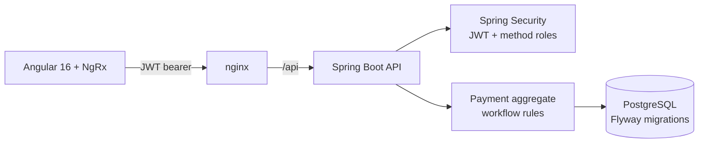

# PayFlow Approvals

[](https://github.com/sameerkhan63731/payflow-approvals/actions/workflows/ci.yml)

A full-stack commercial payments app: corporate users initiate **ACH and wire** payments, and each payment is routed through **multi-level maker-checker approval** before it can be released.

**Stack:** Java 17 · Spring Boot 3 · Spring Security (JWT, role-based access) · Spring Data JPA · Flyway · PostgreSQL · Angular 16 · NgRx · TypeScript · Docker · GitHub Actions

> Independent portfolio project built from common payments patterns. It contains no employer source code, data, or proprietary design.

## What it does

| Role | Can do |
|---|---|
| **Initiator** (`maya`) | Create payments, save drafts, submit for approval |
| **Approver** (`raj`, `lena`) | Approve or reject payments initiated by someone else |
| **Admin** (`omar`) | Everything an approver can, plus release fully approved payments |

### Approval rules

- **Tiered approvals.** The number of distinct approvers depends on type and amount. Wires reach higher tiers sooner because they settle same-day and are hard to recall.

  | Type | 1 approval | 2 approvals | 3 approvals |
  |---|---|---|---|
  | ACH | < $25,000 | $25,000 – $249,999.99 | ≥ $250,000 |
  | Wire | < $10,000 | $10,000 – $99,999.99 | ≥ $100,000 |

- **Maker-checker.** The person who initiates a payment can never approve or reject it, even if they also hold the approver role.
- **One vote per approver.** Each approver counts once, enforced in the domain and by a database unique constraint.
- **Rejections are final and need a reason.** One rejection ends the workflow.
- **Idempotent create.** The UI sends an `Idempotency-Key` per form fill, so a retried or double-clicked submit returns the original payment instead of creating a second one.
- **Optimistic locking.** Two approvers acting at the same moment cannot both win; the second gets a clear `409 CONCURRENT_UPDATE`.
- **Masked account numbers.** Full account numbers never leave the API; responses show only the last four digits.

## Architecture



The workflow rules live in the `Payment` aggregate, not in controllers, so every path that changes a payment goes through the same checks. They are covered by plain unit tests with no Spring context.

## Run it

**With Docker (recommended):**

```bash
docker compose up --build
```

Open http://localhost:4200 and sign in as `maya`, `raj`, `lena`, or `omar` (password `demo-pass`). The `demo` profile seeds five payments in different states.

**Locally for development:**

```bash
# API on :8080 with an in-memory H2 database
cd backend && mvn spring-boot:run -Dspring-boot.run.profiles=demo

# UI on :4200, proxying /api to :8080
cd frontend && npm install && npm start
```

## API

All endpoints except `/api/auth/token` require `Authorization: Bearer <token>`. Errors use RFC 7807 problem responses with a stable `code`.

| Method | Path | Role | Purpose |
|---|---|---|---|
| POST | `/api/auth/token` | — | Exchange demo credentials for a signed JWT |
| POST | `/api/payments` | INITIATOR | Create (optionally submit) a payment; honours `Idempotency-Key` |
| GET | `/api/payments?status=` | any | List payments, newest first |
| GET | `/api/payments/summary` | any | Counts by status |
| GET | `/api/payments/{id}` | any | Payment with its approval trail and `canDecide` for the caller |
| POST | `/api/payments/{id}/submit` | INITIATOR | Move a draft into approval |
| POST | `/api/payments/{id}/approve` | APPROVER | Approve, with an optional note |
| POST | `/api/payments/{id}/reject` | APPROVER | Reject, with a required note |
| POST | `/api/payments/{id}/release` | ADMIN | Release a fully approved payment |

Example:

```bash
TOKEN=$(curl -s localhost:8080/api/auth/token -H 'Content-Type: application/json' \
  -d '{"username":"maya","password":"demo-pass"}' | jq -r .accessToken)

curl -s localhost:8080/api/payments -H "Authorization: Bearer $TOKEN" \
  -H 'Content-Type: application/json' -H 'Idempotency-Key: 6f1c2a' \
  -d '{"type":"WIRE","amount":50000,"currency":"USD","debitAccount":"000123456789",
       "beneficiaryName":"Contoso Steel","beneficiaryAccount":"4400918273","submit":true}'
```

## Tests

```bash
cd backend && mvn verify                 # domain unit tests + MockMvc integration tests
cd frontend && npm run test:ci           # reducer, selector, and service specs
```

The integration tests drive the full flow through HTTP: create → maker-checker block → first approval → duplicate-vote block → second approval → role-checked release, plus validation, 401/403/404 handling, idempotent create, and real token issuance.

## Project layout

```
backend/    Spring Boot API (payment aggregate, security, Flyway migrations, tests)
frontend/   Angular 16 app (standalone components, NgRx store/effects, specs)
docker-compose.yml   PostgreSQL + API + nginx-served UI
```

## Production notes

The demo issues its own HS256 tokens so it runs with no external services. In production the API would validate tokens from the organisation's OIDC identity provider instead, and the next steps would be an audit-event outbox to Kafka, entitlement limits per user, and Testcontainers-based PostgreSQL tests.

## Author

[Sameer Khan Pathan](https://github.com/sameerkhan63731) · [sameerwork.online](https://sameerwork.online)
